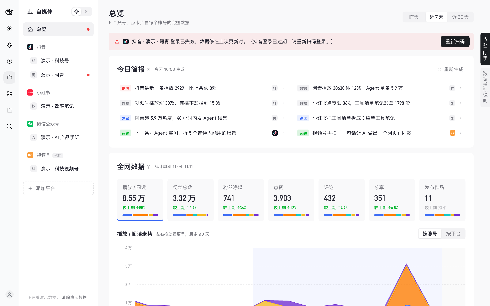
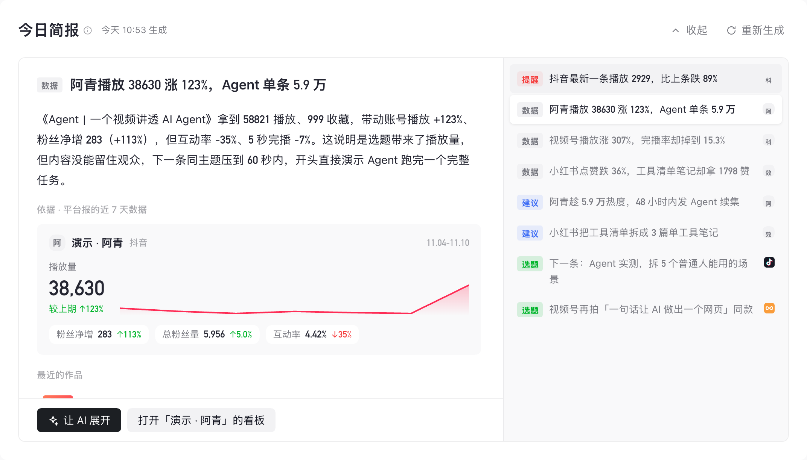
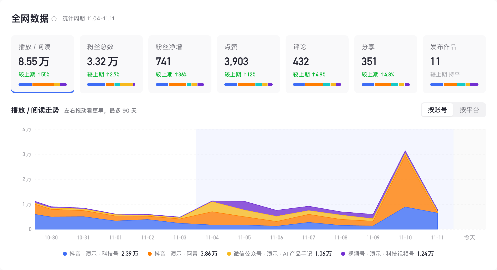
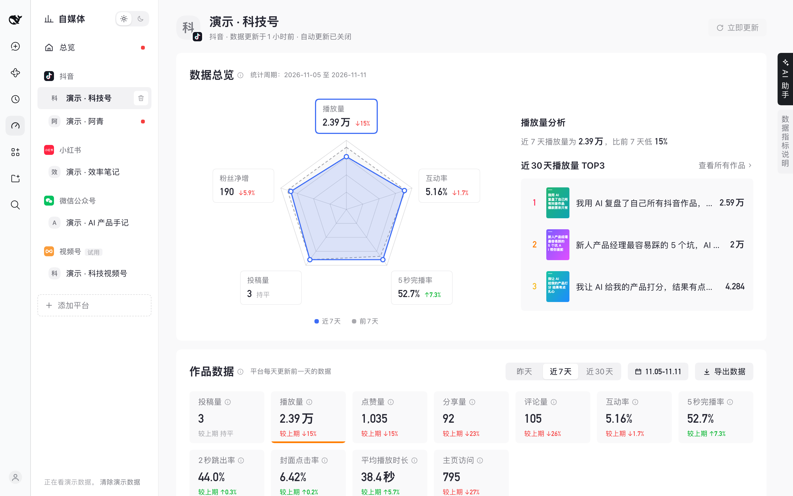
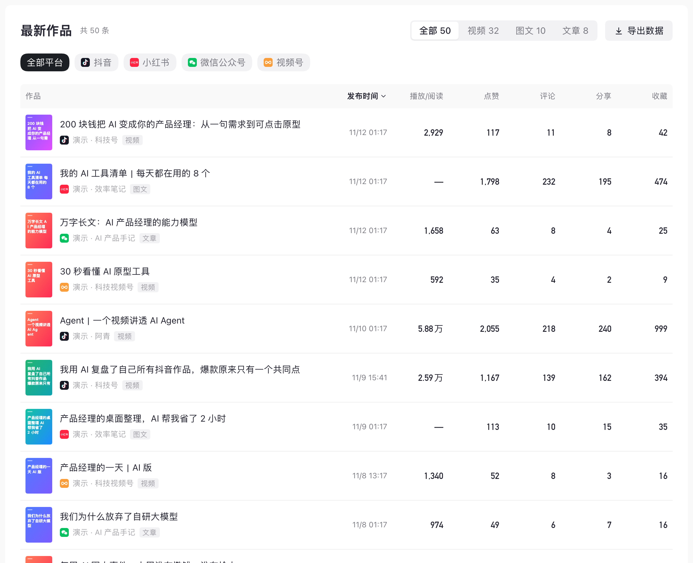

# 自媒体 · DeepSeek Harness 插件

[DeepSeek Harness](https://github.com/deepseek-ai/deepseek-harness)（DSH）的「自媒体」插件：一个页面同时看抖音、小红书、微信公众号、视频号多个账号的数据，不用每天分别打开各平台的创作者后台；右边是读得到这些数据的 AI 助手，可以直接问「我最新那条视频有多少评论」、让它找选题、分析作品。

> **English** — A DeepSeek Harness plugin that puts the creator data of your Douyin, Xiaohongshu (RED), WeChat Official Account and WeChat Channels accounts on one dashboard, with a daily AI brief and an AI assistant that can read the numbers. You log in by scanning a QR code in a built-in headless Chrome; all data stays on your machine. The UI is Chinese with an English fallback.



## 安装

要求：

- DeepSeek Harness **0.2.x**（0.2.2-rc.1 起，之后的 0.2 版本都能装）
- 本机装了 **Google Chrome**：扫码登录和读数据都用它，在后台无头运行，不会弹窗

在 DSH 里打开「插件 → 添加插件」，填下面任意一种，点「安装」：

| 方式 | 填什么 |
|---|---|
| **包名（推荐）** | `@xiaopuai/dsh-media`：从 npm 官方源安装，连不上时 DSH 会自动改用中国大陆镜像源。之后插件页面里能检查更新、一键更新 |
| GitHub | `github:xiaopu-ai/dsh-plugin-media#path:/dsh-media` |
| 压缩包 | 从 [Releases](https://github.com/xiaopu-ai/dsh-plugin-media/releases) 下载 `xiaopuai-dsh-media-<版本>.tgz`（0.4.x 叫 `dsh-media-<版本>.tgz`），填它的绝对路径 |
| 本地文件夹（改代码用） | 克隆仓库后，先在 `dsh-media/` 里运行 `npm install --omit=dev --legacy-peer-deps`，再填 `dsh-media` 文件夹的绝对路径 |

命令行也一样：`dsh plugin --profile desktop add @xiaopuai/dsh-media`（`desktop` 换成你的 profile）。

装好后左侧栏出现「自媒体」（英文界面叫 Media）。第一次打开只有「添加你的第一个账号」：选平台 → 用手机 App 扫窗口里的二维码 → 插件认出是哪个账号 → 确认添加。每个平台最多 3 个账号。之后后台每隔几个小时自动更新一次，也可以随时点「立即更新」。

升级：

- **按包名装的**：在 DSH「插件」里打开「自媒体」，下面的「版本」一栏会检查新版本，有新版本时点「更新」。DSH 只会列出和你当前 DSH 兼容的版本。
- **从 GitHub 或压缩包装的**：不会自动更新，也没有「更新」按钮。用同样的方式再装一次，或者运行 `dsh plugin --profile desktop update @xiaopuai/dsh-media`。
- 升级后重启 DSH。账号、登录状态和数据存在 DSH 的 profile 里，升级、重装都不会丢。
- 0.5.0 起包名从 `dsh-media` 改成了 `@xiaopuai/dsh-media`（为了发到 npm）。装过 0.4.x 的，在「插件」里先删除旧的「dsh-media」，再按包名装新的；数据还在。

**和 DSH 版本的关系**：插件声明支持 DSH `>=0.2.2-rc.1 <0.3.0-0`（0.2.2-rc.1 到所有 0.2.x，不含 0.3 的预览版）（`dsh-media/package.json` 的 `engines.dsh`），DSH 安装和启动时都会核对。DSH 之后的 0.2 版本（0.2.2 正式版、0.2.3……）照常能装；DSH 升到 0.3 时插件 API 可能变，DSH 会拒绝安装并提示「不兼容」，那时请装本仓库对应的新版本。装不上、提示「不兼容」时：DSH 太旧就先升级 DSH（左下角「新版本」）；DSH 已经是 0.3 或更新而这里还没出新版本，请提 [issue](https://github.com/xiaopu-ai/dsh-plugin-media/issues)。

## 数据和隐私

- **数据只在你自己的电脑上。** 每个账号的登录状态存在 DSH profile 下单独的浏览器资料里，读到的数据存在 profile 下的 `media-suite/` 文件夹。除了各平台自己和你在 DSH 里配置的模型（只在生成「今日简报」、用 AI 助手时把相关数字发给它），插件不往任何地方发数据。
- **只读你自己的账号。** 读的是你扫码登录后、在各平台创作者后台本来就看得到的数据，和你自己在浏览器里打开没有区别。
- **声明：** 本项目是个人开源项目，与抖音、小红书、微信、DeepSeek 均无关联。平台改版可能让某项数据暂时读不到；请遵守各平台的用户协议，自行承担使用风险。

## 页面长什么样

```
左边一列                 中间看板（照抖音创作者中心「数据中心」，所有平台同一套）                    右边缘 / 右边（可收起）
｜总览                   ① 数据总览：五维雷达图（近 7 天 vs 前 7 天）+「X分析」一句话 + TOP3（带封面）   竖条「AI 助手」「数据指标说明」
｜[抖音logo] 抖音 [+]    ② 作品数据：昨天 / 近7天 / 近30天，指标卡切换折线图，导出数据                 AI 助手（DSH 自己的对话）
｜   账号A  [删除]       ③ 粉丝数据：同上（总粉丝量、粉丝净增、吸粉量、脱粉量、回访粉丝量）            输入框上方固定三个模块：
｜   账号B ●             ④ 全部作品：封面 + 标题 + 各项数字，可排序、可导出，点一条弹出作品详情         找选题 · 最新作品分析 · 导出数据
｜[+ 添加平台]
```

以下截图都是插件自带的演示数据（`演示 · …` 账号），不是真实账号。

| 今日简报：点一条就地展开 | 全网数据：合计、占比和可拖动的走势 |
|---|---|
|  |  |
| **账号看板**：数据总览雷达图、作品数据 | **最新作品**：列表，可排序、筛平台、导出 |
|  |  |


- **总览**（从上往下）：
  - **今日简报**：每天早上 9 点（北京时间）后台按各平台的数自动写一份，没赶上的话第一次打开总览时当场写，一行一行流出来。只有 5–8 行，每行一句不超过 28 个字、带数字，前面一个标签：提醒（停更、掉粉、数据异常）、数据（值得知道的变化）、建议（下一步具体做什么）、选题（下一条写什么）。点一行就在卡片里展开，不跳走：左边是这一条的详细说明（依据哪些数 + 具体怎么做，60–120 字）、依据的数（说到的账号近 7 天的主数、走势和几个次要的数，全是平台报的；没指名账号的看全网合计）、说到的那条作品（点开是作品详情弹窗），底下「让 AI 展开」/「让 AI 写成脚本」（带上这条的说明送进右边的 AI 助手）和「打开某账号的看板」；右边是其余几条，点哪条换哪条，↑↓ 也能换，Esc 或「收起」回到列表。展开的框大小固定（宽:高 = 2:1，高度在 420–560 之间），换哪一条页面都不跳：说明长了在框里上下滑，两个按钮一直钉在底下。窄的时候上下排，上面说明 440 高、下面列表 220 高，也是固定的。可以随时「重新生成」。存在后台，换设备、刷新都还在；之前生成的简报没有详细说明，会提示重新生成。
  - **全网数据**：播放 / 阅读、粉丝总数、粉丝净增、点赞、评论、分享、发布作品，各平台直接相加不去重；每张卡片下面一条横条是各账号的占比，点卡片换下面的走势图。走势图最长 90 天（各平台一次只给 30 天，之后每天更新往后接），打开时停在今天，鼠标或触控板左右拖可以往前翻；「按账号 / 按平台」切换怎么分颜色；平台还没报的日子是灰底，停上去看当天每个账号和合计（没报的写「未报告」）。「多平台同步发布」列出一周内发在不同平台、标题相同或相近的作品，数字合计。
  - **各账号数据**：苹果风格的便当盒，按选中的维度（热度 = 播放 / 观看 / 阅读，粉丝，粉丝净增，互动率，点赞，评论，分享）从高到低排，最大的放最大格，带走势小图；点一格进入账号看板。
  - 右上角的「昨天 / 近7天 / 近30天」同时管全网数据和各账号数据。
  - **最新作品**：列表。全部 / 视频 / 图文 / 文章切换（带条数），按平台筛；每行封面、标题、平台和账号，后面是发布时间、播放 / 阅读、点赞、评论、分享、收藏，点列头排序，平台不给的数写「—」；每页 20 条，可导出。
  - **同一平台多个账号**：每个账号一种颜色，图例写「平台 · 账号名」，全网卡片的占比条、走势图、便当盒都按账号分；走势图可以切「按平台」把同平台的账号合成一条；最新作品按平台筛时同平台的账号一起出来，每行写着是哪个账号。
  - **以后加的平台**（少数派、X 等）：平台在后台登记自己的名字、品牌色和指标（各自叫「阅读」「浏览」「曝光」……），总览不用改：全网数据的「播放 / 阅读」把各平台自己的主要曝光数加起来，占比条里看得出各自多少；作品按视频 / 图文 / 文章归类；平台不报的指标那一块不出现；没有画好 logo 的平台用品牌色加平台名第一个字。
- **日间 / 夜间**：左上角「自媒体」右边的胶囊（太阳 / 月亮），默认日间，记在本机。管整个插件页面，包括弹窗和右边的 AI 助手，不管 DSH 自己是浅色还是深色。
- **第一次打开**：还没有账号时，中间只有「添加你的第一个账号」和四个平台（抖音、小红书、公众号、视频号），没有演示数据。加了第一个账号以后才出现左边一列和看板。
- **左边一列**：每个平台前面是它的 logo，只显示已经加了账号的平台。平台名停上去出现「添加账号」，每个平台最多 3 个（后台也会拦）；账号名停上去出现删除。
- **账号状态**：登录失效、更新失败、数据过期时，账号名后面出现红点或黄点，「总览」和 DSH 左侧栏的图标上也会有红点。看板顶上会说明原因，并给出「重新扫码」或「立即更新」按钮。每个看板都写着「数据更新于…」。
- **数据总览**：雷达图的五个维度按平台给的指标挑（抖音：播放量、互动率、5秒完播率、投稿量、粉丝净增）。抖音的第二层是「同类作者」，平台不给同类作者的数，这里第二层画的是自己的前 7 天。点一个维度，右边的分析句和 TOP3 跟着换。维度凑不够 3 个的平台不画雷达图，改成一行说明。
- **只画平台给的数**：所有数字都来自平台自己的报告（作品列表、创作者中心的每日数据），不拿作品数字前后相减去估。平台没有的指标整块不出现，不会出现一排「—」。指标按平台的叫法显示，比如公众号叫「阅读量」、视频号叫「发布视频数」。
- **作品详情**：弹窗，只有「总览」：封面、标题、发布时间，各项数字和同账号近期中位数比，几个比率（点赞率、评论率……），在近期作品里排第几。底部有「让 AI 分析这条」。
- **导出数据**：作品数据、粉丝数据按当前时间范围导出每天的数字；全部作品、总览的最新作品导出列表（标题、完整发布时间、各项数字、链接）。都是 CSV，Excel 和 WPS 直接能开。
- **AI 助手**：用的是 DSH 自己的对话，读得到上面所有数据（工具：`media_accounts`、`media_overview`、`media_posts`、`media_post`、`media_topics`、`media_analyze`），所以「我最新那条视频有多少评论」这类问题可以直接问。右上角按钮或右边缘竖条「AI 助手」拉出来，收起后对话还在。对话放在「文稿/自媒体」这个工作区里，AI 导出的表格也存在这里。
- **数据指标说明**：右边缘竖条，点开是抽屉：数据什么时候更新、每个指标怎么算、为什么有的指标没有。

## 数据从哪来、还缺什么

| 数据 | 来源 | 状态 |
|---|---|---|
| 粉丝、获赞、作品列表、封面和每条的数字 | 扫码登录后，后台每隔几个小时自动读一次 | 四个平台都已接好，并用真实账号和各平台后台逐项核对过（视频号在界面里仍标「试用」） |
| 抖音每天的播放、点赞、评论、分享、主页访问、5 秒完播率、2 秒跳出率、封面点击率、平均播放时长，粉丝总数、净增、吸粉、脱粉、回访粉丝 | 抖音创作者中心「数据中心」的接口（`/janus/douyin/creator/data/overview/dashboard` 和 `/fans`） | **已接，2026-11 用真实账号核对过**：近 7 天的数字和创作者中心逐项一致 |
| 视频号的账号、全部视频（封面、播放、👍点赞、♡喜欢、评论、转发、完播率）、每天的播放 / 点赞 / 喜欢 / 评论 / 转发和关注者总数 / 净增 / 新增 / 取消 | 视频号助手：`auth/auth_data`、视频管理的 `post/post_list`、数据中心的 `statistic/new_post_total_data` 和 `statistic/fans_trend` | **已接，2026-11 用真实账号核对过**，和视频号助手的数逐日一致。每日数据先有近 7 天，之后每次更新往后补 |
| 小红书每天的曝光、观看、点赞、收藏、评论、分享、主页访客、新增 / 取消关注、净涨粉、封面点击率、视频完播率、平均观看时长；笔记封面 | 小红书创作服务平台的 `datacenter/account/base`（扫码登录小红书网页版后同一个登录就能打开）；封面来自公开主页 | **已接，2026-11 用真实账号核对过**，近 7 天逐项和创作服务平台一致，一次补全 30 天。注意平台给每天打的时间戳是「这一天结束的那个零点」 |
| 公众号每天的阅读（人）、分享（人）、新关注 / 取消关注 / 净增 / 累计关注；近期文章的阅读数、文章封面、账号头像 | 公众号后台：数据分析 → 内容分析（`misc/appmsganalysis` 的 `get_article_stat_tendency_and_source`、`get_article_list`）、用户分析（`misc/useranalysis`）；发表记录（`cgi-bin/appmsgpublish`） | **已接，2026-11 用真实账号核对过**，一次补全 31 天。公众号后台不给每天的点赞、留言，所以公众号不显示「互动率」（只有分享没法算，硬算会把分享率当成互动率） |
| 粉丝画像、作品的流量来源和观众画像、评论热词 | 各平台创作者后台的接口 | **还没接**，要用真实登录的账号来开发和验证 |

统计周期和平台一致：到平台最后报告的那一天为止（平台每天中午前后才给出前一天的数，所以上午通常到前天）。次数类的数字是每天相加；完播率、跳出率、封面点击率、平均播放时长这类比率，近 7 天、近 30 天直接用平台自己算好的那个数（比如封面点击率要按曝光加权，平台不给曝光，自己算会偏），走势图画的是每天的值。每个数字怎么算的，鼠标停在指标卡的 ⓘ 上，或者打开右边缘的「数据指标说明」。

## 扫码登录

插件用一个看不见的 Chrome 打开平台的登录页，把画面实时转到插件页面里，你在手机 App 上扫页面里的二维码就行。

抖音的二维码大约 **60 秒** 就失效。失效后它还留在页面上，只是盖了一层「二维码已失效 点击刷新」，手机照样扫得出来，扫了只会提示失效。所以登录窗口会一直盯着：看到平台自己的「已失效 / 已过期」提示，就替你点一下页面上的刷新，屏幕上的二维码永远是能用的（每个平台都开着，抖音实际验证过）。

几个容易踩的坑，现在都处理了：

- **新开的登录页慢多半在网络**：开发时逐段量过，抖音新登录页从点下去到二维码出来约 25 秒，其中浏览器启动 0.8 秒，其余都是抖音网页本身大约 6 轮先后依次的请求；那台机器连国内网站每建一个新连接要 1.5–3 秒。不开画面转播、关掉 QUIC、用热缓存都不会更快，网络好的地方会快很多。
- **插件自己的响应都在 0.2 秒内**：点击、拖动、打字从发出到窗口里画面变化 8–107 毫秒（连发 40 次鼠标移动之后也是 6–93 毫秒）；画面约每秒 55 帧。做法：
  - 操作在页面这边一条一条按顺序发，在后台也一条一条执行；还没发出 / 还没执行的鼠标移动（没按着键）直接换成最新位置，移动再多也堆不起来、挡不住后面的点击。按着键拖动时每一步都保留（滑块验证要完整轨迹）。以前每个操作各发一个请求，同时最多 6 个，后面的要排队、还可能乱序。
  - 按下鼠标的那一刻就在点的位置画一个圈，不等远端的下一帧。
  - 网页还在加载时窗口顶上有一条细进度条（跟着 Chrome 自己的加载状态）；扫码登录时顶上一行每秒写着到了哪一步、过了几秒：「正在启动浏览器… → 正在连接抖音… → 抖音登录页加载中，二维码出来就能扫…」，8 秒后补一句「网络慢时要二三十秒，页面一直在加载，不是卡住了」。二维码出现过或网页加载完就不再计时。
  - 浏览器只启动一次：以前每次 DSH 启动后第一次打开都要启动两遍 Chrome（第一遍只为读出 User-Agent），现在记在资料目录的 `.user-agent.json` 里，用 CDP `Browser.getVersion` 核对 Chrome 没升级就直接用；启动从 3.6–6 秒降到 0.8 秒。
  - 二维码出来之前每 0.3 秒找一次（之后照旧 1.5 秒），二维码一画出来就送到窗口。
- **视频号的二维码在微信自己的 iframe 里**（`open.weixin.qq.com`）。找二维码、看它过没过期、点刷新，都会进到 iframe 里找。
- **不能只看网址判断登录**：视频号会先显示后台地址、几秒后才把没登录的人送去登录页。插件以前把这几秒当成「已登录」，马上在第二个标签页里识别账号，那个标签页自己的登录页会顶掉你正在扫的二维码。现在视频号要同时有登录 Cookie（`sessionid`）和真正画出来的后台页面才算登录；所有平台的「已登录」都要连续两次检测（隔 2 秒以上）才算数。
- **视频号的名字**：`auth_data` 里有两个昵称，`userAttr` 是管理员的微信号，`finderUser` 才是视频号；只取后者。

## 仓库里有什么

| 文件夹 | 是什么 |
|---|---|
| `dsh-media/` | **装的就是这个。** 一个完整的 DSH 插件包：后台（`lib/`，已编译好）、页面（`client.js`）、画面转接和 AI 助手工作区（`ui.js`）。 |
| `backend/` | 后台的源码和测试。只有改后台时才用得到，改完用 `build.sh` 重新生成 `dsh-media/lib/`。 |

## 开发

- **改页面**：改 `dsh-media/client.js`。想换样子改第 1 段「外观」（各平台的识别色、看板的 `--$-dy-*` 都在这里）；看板在第 3V 段。用本地文件夹方式装的，保存就生效（DSH 会切回对话首页，再点一下「自媒体」就行）。
- **改画面转接或 AI 助手的工作区**：改 `dsh-media/ui.js`，要重启 DSH。工作区默认是 `~/Documents/自媒体`，可以在 profile 的 `cordis.patch.yml` 里给 `id: media-ui` 那一行写 `config: { workspaceDir: 绝对路径 }`。
- **改后台**：改 `backend/src/`，然后运行 `sh backend/build.sh <DSH 源码目录>` 重新生成 `dsh-media/lib/`，再重装插件。后台用到 DSH 的内部包和 typert 生成器，所以要借 DSH 源码树编译，步骤都在 `build.sh` 里：

  ```sh
  git clone --depth 1 --branch dsh-v0.2.2-rc.2 https://github.com/deepseek-ai/deepseek-harness.git
  sh backend/build.sh ./deepseek-harness
  ```

  DSH 源码的版本要和装的 DSH 一致。插件包名会写进生成的接口描述（`lib/typert.host.js`），所以改包名也要重新编译。测试在 DSH 源码目录里运行：`pnpm exec vitest run packages/experimental/media-suite/tests`。
- **看平台接口返回了什么**（开发用）：启动 DSH 前设环境变量 `DSH_MEDIA_CAPTURE_DIR=<文件夹>`。之后：
  - 每次更新账号（抖音、视频号），平台后台返回的 JSON 都存一份到这个文件夹，抖音另外会多打开作品分析、粉丝、作品管理三个页面；
  - 在插件窗口里打开的平台页面，返回的数据也一样存下来；
  - 登录窗口的每一步写进 `login-trace.log`：页面和 iframe 的跳转、二维码轮询的状态码（比如微信的 `wx_errcode` 408 等待 / 404 已扫 / 405 已确认）、失败的请求、弹窗。只记路径和状态，不记登录凭证。
  不设就完全不生效。文件里是账号的真实数据，用完删掉。页面上还有一个开发用入口：`localStorage` 里 `dsh-media.dev` 设成 `1` 后，控制台里可以用 `__mediaFace.openBrowser(平台, 网址, 'browse', 账号 id)` 打开某个账号自己的平台页面。
- **看演示数据**：在 DSH 页面里打开开发者工具，运行 `localStorage.setItem('dsh-media.dev', '1')` 再刷新，空页面下方会多一个「载入演示数据（开发用）」。5 个演示账号覆盖 4 个平台，其中一个演示「需要重新扫码」的样子，作品带演示封面。看完在左边一列底部「清除演示数据」。正式用户看不到这个入口。
- **改后台配置**：在 DSH profile 自己的 `cordis.patch.yml` 里按 `id: media-suite` 覆盖，全部配置项见 `backend/src/index.ts` 的 `Config`。常用的几项：
  - `dataDir`：数据放哪，默认是 profile 目录下的 `media-suite/`。
  - `executablePath`：Chrome 的位置。
  - `maxAccountsPerPlatform`：每个平台最多几个账号，默认 3。
  - `staleHours`：多少小时没更新算数据过期，默认 30。
  - `historyDays`：每次更新后补多少天的历史，默认 30（各平台后台最多给 30 天：抖音要 90 天时粉丝接口回「参数不合法」）。补过的日子一直留着，总览的 90 天走势图靠每天的更新攒起来。
  - `briefHour`：今日简报每天几点（北京时间）自动写，默认 9。
  - `defaultIntervalMinutes`：自动更新的间隔。

`backend/README.zh.md` 是后台原来的详细说明（接口、配置、行为），里面的包名还是改名前的 `@deepseek-ai/dsh-media-suite`，现在叫 `dsh-media`。

## dsh-media/client.js 的结构

- 0 名字：插件 id、类名前缀
- 1 外观：颜色、圆角、字体、各平台识别色都在这段。看板用的一套（`--$-dy-*`：字体、数字字体、底色、文字色、分段控件、主按钮、指标色）是照抖音数据中心实测的值，深色模式的值紧跟在下面
- 2 底座：通用组件（外框、菜单、卡片、按钮、表格……），原样来自底座 0.5，别在这里改
- 2b 补的组件：底座里还没有的小图表、封面等
- 3 调后台、数据小工具、登录用的小浏览器
- 3V 看板：3V.1 页面的数据 · 3V.2 设计系统（按钮、分段、卡片、指标卡、折线图、雷达图、平台 logo、封面、导出）· 3V.3 左边一列 · 3V.4 第一次打开 · 3V.5 总览 · 3V.6 账号看板 · 3V.7 作品详情弹窗 · 3V.8 添加平台和指标说明 · 3V.9 AI 助手 · 3V.10 整个页面；样式在这一段末尾，类名都以 `dy-` 开头
- 文案（中文、英文各一份；看板的在 `TEXT_V2`）
- 4 挂载

三条规矩：色值只写在「外观」段；类名都走 `cls()`；不引用 DSH 自带组件库、不动 `body`、不用 iframe。行内样式里要用外观段的变量时写 `` `var(--${P}-名字)` ``（`$-` 只在样式表里会被换掉）。


## 许可

[MIT](LICENSE) © 2026 xiaopu-ai
