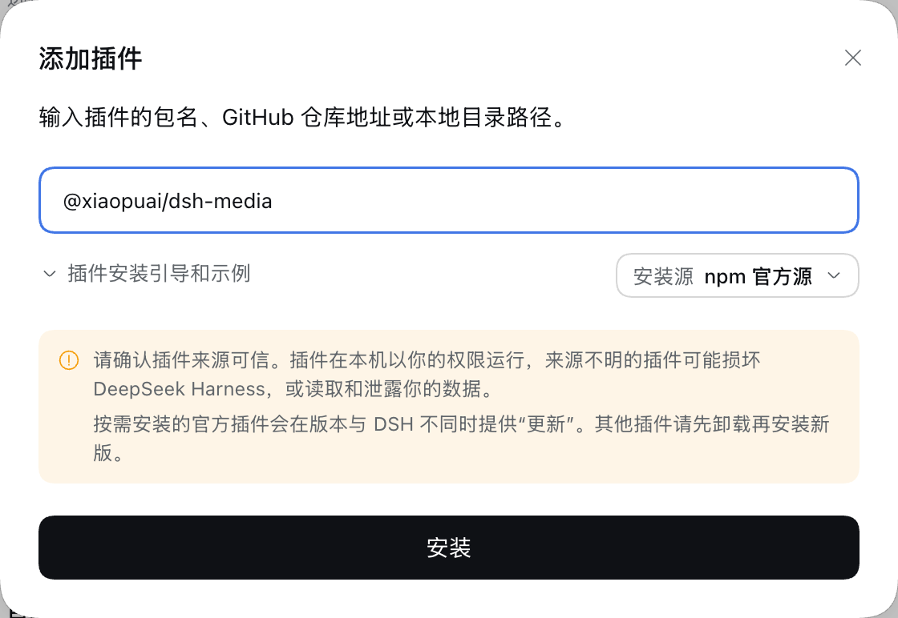
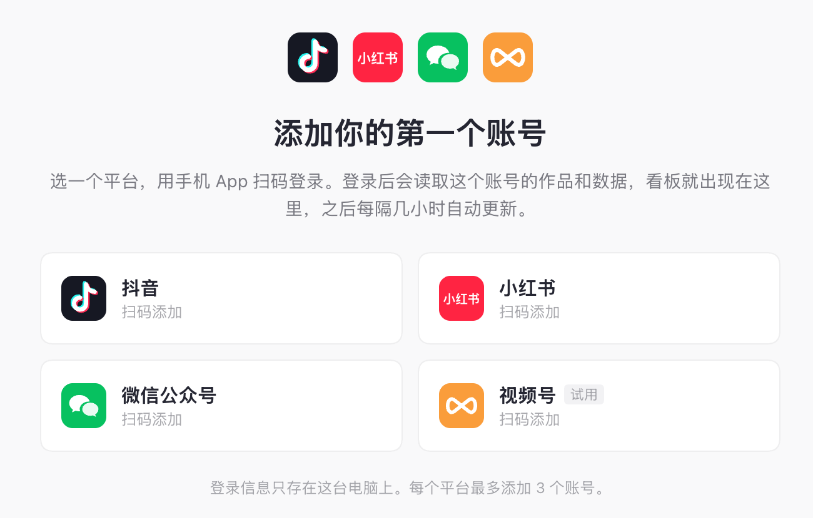

<div align="center">


# 自媒体

**抖音、小红书、公众号、视频号的数据，一个页面看完。**

DeepSeek Harness 插件 · 扫码登录 · 每日 AI 简报 · 数据只存在你自己的电脑上

[](https://www.npmjs.com/package/@xiaopuai/dsh-media)
[](https://github.com/deepseek-ai/deepseek-harness)
[](LICENSE)

[三步开始](#三步开始) · [能做什么](#能做什么) · [常见问题](#常见问题) · [功能详解](docs/FEATURES.md) · [English](#english)

</div>

<br>


<p align="center"><sub>截图里是插件自带的演示数据，不是真实账号。</sub></p>

## 能做什么

| | |
|---|---|
| 📊 **一个页面看全部账号** | 抖音、小红书、微信公众号、视频号，每个平台最多 3 个号，不用再一个个打开创作者后台 |
| 📰 **每天一份 AI 简报** | 每天早上 9 点自动写好：哪个号停更了、哪条数据涨了、下一条发什么。点开一条，就能看到依据和具体做法 |
| 📈 **全网数据合计** | 播放、粉丝、点赞……所有平台加在一起看，走势图能往前翻 90 天 |
| 🤖 **会看数据的 AI 助手** | 直接问「我最新那条视频多少评论」「帮我想下一条选题」 |
| 🔒 **数据只在你电脑上** | 扫码登录，账号和数据都存在本机，不经过任何第三方服务器 |

## 三步开始

**开始前准备好：**

- 电脑上装好了 [DeepSeek Harness](https://github.com/deepseek-ai/deepseek-harness)（0.2.x 版本）
- 电脑上装好了 [Google Chrome](https://www.google.com/chrome/)（插件用它扫码登录、读数据，在后台运行，不会弹出来）
- 手机上有要登录的平台 App：抖音、小红书或微信

### ① 安装插件

1. 打开 DeepSeek Harness，点左边的 **插件**
2. 点右上角的 **添加插件**，在输入框里填：

   ```
   @xiaopuai/dsh-media
   ```

3. 点 **安装**。装好后点 **立即启用**，左边会多出一个 **自媒体**



> [!TIP]
> 提示「不兼容」、装不上？说明 DeepSeek Harness 的版本太旧了。点左下角的 **新版本** 升级，再装一次。

### ② 扫码添加账号

1. 点左边的 **自媒体**，在页面上选一个平台
2. 打开手机上对应的 App，扫窗口里的二维码，在手机上确认登录
3. 插件认出是哪个账号后，点 **添加为我的账号**



> [!NOTE]
> 第一次打开登录页可能要等一会儿，网络慢时要二三十秒。窗口顶上会写着现在到了哪一步、过了几秒。二维码过期了插件会自动换新的，扫屏幕上最新的那个就行。

### ③ 看数据

账号加好后，插件马上读取它的作品和数据，之后每隔几个小时自动更新一次，也可以随时点 **立即更新**。

- **总览**：今日简报、全网数据、各账号对比、最新作品
- **左边点某个账号**：这个号的数据总览、作品数据、粉丝数据和全部作品，每一块都能导出 Excel 能打开的表格
- **右边缘的「AI 助手」**：点一下拉出来，直接用中文问

| 今日简报：点一条，就地展开说明 | 账号看板：雷达图和每天的数 |
|:---:|:---:|
|  |  |
| **全网数据：所有平台合计和走势** | **最新作品：可排序、筛平台、导出** |
|  |  |

喜欢暗色的话，点左上角「自媒体」旁边的月亮，切到夜间模式。

## 常见问题

<details>
<summary><b>装不上，提示「不兼容」</b></summary>

<br>

插件支持 DeepSeek Harness **0.2.2-rc.1 及之后的所有 0.2 版本**。提示不兼容，多半是 DeepSeek Harness 太旧：点左下角 **新版本** 升级后再装。

如果 DeepSeek Harness 已经是 0.3 或更新、而这里还没出对应的新版本，请[提一个 issue](https://github.com/xiaopu-ai/dsh-plugin-media/issues)。

</details>

<details>
<summary><b>二维码要等很久，或者一直在加载</b></summary>

<br>

登录页是直接打开各平台的官方网页，第一次打开要把整个网页下载下来，网络慢时要二三十秒。窗口顶上会实时显示进度，页面一直在加载就不是卡住了。

等了一分钟以上还是空白，可以关掉窗口再点一次平台；还不行请[提 issue](https://github.com/xiaopu-ai/dsh-plugin-media/issues)，附上截图。

</details>

<details>
<summary><b>为什么隔一阵子要重新扫码？</b></summary>

<br>

各平台的登录都有期限，插件会尽量帮你续上：

- **公众号**：登录 4 天不用就过期，每访问一次重新算 4 天。DeepSeek Harness 开着时，插件每天至少访问一次，所以只要 4 天内开过它就不会掉。
- **视频号**：闲置几个小时就会被平台退出登录。DeepSeek Harness 开着时，插件每 30 分钟轻轻打开一次视频号助手首页（不读数据），实测这样能一直保持登录。
- **抖音、小红书**：一次登录能用一两个月以上。

电脑睡眠、合上盖子或 DeepSeek Harness 关掉太久，登录还是可能过期。过期后账号名旁会出现红点，点 **重新扫码**、用手机扫一下就好，数据都在。另外，在别的电脑或浏览器上登录同一个视频号助手，可能会把插件这边的登录挤掉。

</details>

<details>
<summary><b>数据多久更新一次？为什么看不到今天的数？</b></summary>

<br>

插件每隔几个小时自动读一次，随时可以点 **立即更新**。

插件只显示各平台自己报告的数字。平台一般要到每天中午前后，才给出前一天的完整数据，所以上午通常只能看到前天为止的数。这是平台的规则，和平台后台里看到的一致。

</details>

<details>
<summary><b>我的账号和数据安全吗？</b></summary>

<br>

- 登录状态和读到的数据都只存在你这台电脑上（DeepSeek Harness 的资料文件夹里），插件不会发到任何第三方服务器。
- 插件读的是你扫码登录后、在各平台创作者后台本来就看得到的数据，和你自己用浏览器打开没有区别。
- 只有在生成「今日简报」、使用 AI 助手时，才会把相关数字发给你在 DeepSeek Harness 里设置的模型。

</details>

<details>
<summary><b>怎么升级插件？</b></summary>

<br>

按上面的方法（填包名）装的：在 **插件** 里打开 **自媒体**，页面下方的 **版本** 一栏会自动检查新版本，有新版本时点 **更新**，然后重启 DeepSeek Harness。账号和数据都会保留。

从 GitHub 地址或压缩包装的：不会自动提示更新，用同样的方式再装一次即可。

</details>

<details>
<summary><b>DeepSeek Harness 升级后，插件还能用吗？</b></summary>

<br>

在 0.2 系列里升级（比如 0.2.2、0.2.3），插件照常能用。

升到 0.3 时插件接口可能有变化，DeepSeek Harness 会先暂停这个插件，自己正常启动，数据不受影响。到时装这里对应的新版本就能恢复。

</details>

<details>
<summary><b>能加几个账号？支持哪些平台？</b></summary>

<br>

支持抖音、小红书、微信公众号、视频号，每个平台最多 3 个账号。视频号标着「试用」，数据已经和视频号助手核对过，但用的人还少。

</details>

<details>
<summary><b>今日简报和 AI 助手要花钱吗？</b></summary>

<br>

插件本身免费。今日简报和 AI 助手用的是你在 DeepSeek Harness 里设置的模型，按那个模型的规则计费；今日简报每天只自动写一次。

</details>

<details>
<summary><b>怎么删除账号、卸载插件？</b></summary>

<br>

- **删除账号**：鼠标停在左边的账号名上，点出现的删除按钮。
- **卸载插件**：在 **插件** 里打开 **自媒体**，点右上角 **卸载**。读到的数据留在 DeepSeek Harness 的资料文件夹里，重新安装后还在。

</details>

## 更多

- 📖 [功能详解](docs/FEATURES.md)：每个页面、每个数字是怎么来的，数据从哪里读，扫码登录怎么工作
- 🛠️ [开发者文档](docs/DEVELOPMENT.md)：其他安装方式、改代码、自己编译、调后台配置
- 💬 有问题或想法：[提一个 issue](https://github.com/xiaopu-ai/dsh-plugin-media/issues)

## English

**自媒体 (Media)** is a [DeepSeek Harness](https://github.com/deepseek-ai/deepseek-harness) plugin that puts the creator data of your Douyin, Xiaohongshu (RED), WeChat Official Account and WeChat Channels accounts on one dashboard, with a daily AI brief and an AI assistant that can read the numbers. You log in by scanning a QR code in a built-in headless Chrome, and all data stays on your machine. The UI is in Chinese with an English fallback.

**Install:** in DeepSeek Harness 0.2.x, open **Plugins → Add plugin**, enter `@xiaopuai/dsh-media` and click **Install**. Google Chrome must be installed.

## 声明

本项目是个人开源项目，与抖音、小红书、微信、DeepSeek 均无关联。平台改版可能让某项数据暂时读不到。请遵守各平台的用户协议，自行承担使用风险。

## 许可

[MIT](LICENSE) © 2026 xiaopu-ai
