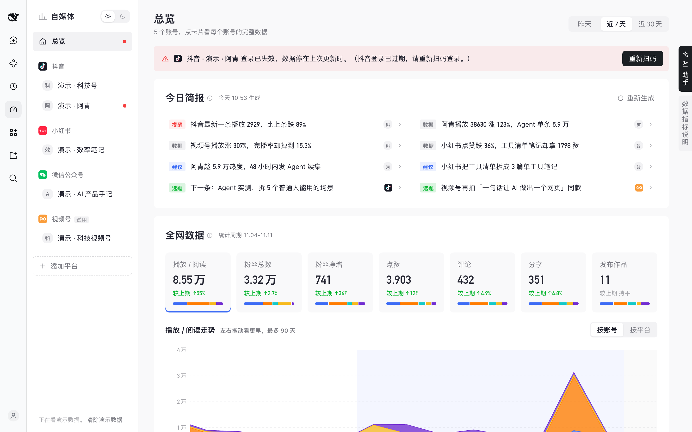

# 自媒体

**抖音、小红书、公众号、视频号的数据，一个页面看完。**

DeepSeek Harness 插件：扫码登录、每日 AI 简报、全网数据合计、会看数据的 AI 助手。账号和数据只存在你自己的电脑上。

## 安装

在 DeepSeek Harness 0.2.x（0.2.2-rc.1 起）里：**插件 → 添加插件**，填 `@xiaopuai/dsh-media`，点 **安装**，再点 **立即启用**。电脑上要装好 Google Chrome。

## 装好以后

1. 点左边的 **自媒体**，选一个平台
2. 用手机上对应的 App 扫窗口里的二维码，再点 **添加为我的账号**
3. 在 **总览** 看今日简报和全网数据；右边缘的 **AI 助手** 可以直接问

**升级**：在 **插件 → 自媒体** 页面下方的 **版本** 一栏点 **更新**，账号和数据都会保留。

更多截图、常见问题和详细说明：https://github.com/xiaopu-ai/dsh-plugin-media

MIT © 2026 xiaopu-ai
